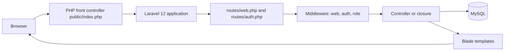

# 01 — System architecture

This chapter explains how Medicare is put together. It uses this repository, not a generic Laravel diagram.

## The picture in one paragraph

A person uses a browser. The browser sends an HTTP request to PHP. PHP starts in `public/index.php`, boots Laravel, and Laravel matches the URL to a route. The route runs middleware, then a controller. The controller reads or writes MySQL through Eloquent models and returns either HTML (a Blade view) or a redirect. The browser draws that HTML and then loads CSS and JavaScript that Vite built from `resources/css/app.css` and `resources/js/app.js`.



Plain-language reading of the diagram: the browser never talks to MySQL. It only talks to PHP. PHP decides which records to load and which HTML to send back. Tailwind and Alpine change how that HTML looks and how small widgets behave. They do not decide who may see a patient record. That decision is made in PHP before the HTML is built.

## Server-rendered pages, not a separate frontend app

**Simple definition:** The server builds the HTML. The browser displays it.

**Technical definition:** Medicare uses server-side rendering. Controllers return `view(...)` or `redirect()`. There is no React or Vue single-page application. `tailwind.config.js` mentions `resources/**/*.vue`, but there are no Vue components in the project. That content path is unused.

**Why this application uses it:** Forms, dashboards, and public pages are Blade templates. A few interactions use `fetch` or Alpine against JSON routes (review lists, visit messages, patient search, analysis status, referral preview). Those are extras on top of full page loads.

**When not to use this style:** A phone app that needs a JSON API for every screen. This repo only exposes `GET /api/user` for Sanctum. The product is the website.

## MVC, as this application actually uses it

MVC means Model, View, Controller.

| Piece | Role in a textbook | Role in Medicare |
|---|---|---|
| Model | Data and relationships | `app/Models/*.php`. Example: `Appointment` maps to the `appointments` table and defines `patient()`, `doctor()`, `reports()` |
| View | HTML | `resources/views/**/*.blade.php` |
| Controller | Receives the request and chooses the response | `app/Http/Controllers/**/*.php` |

The textbook split is incomplete here. Business rules also live in:

- `app/Services/AppointmentBooking.php` (slots, booking, reschedule, payment branch)
- `app/Services/ReferralSender.php`, `AppointmentReports.php`, `ClinicNotifier.php`, `StripeCheckout.php`
- `app/Services/AI/*` (external clinical summary)
- `app/Support/*` (catalog data, file responses, presenters, mock referral samples)
- Form requests in `app/Http/Requests/`
- One policy: `app/Policies/AiAnalysisPolicy.php`

There is no repository layer and no `app/Actions` directory. Controllers often query Eloquent directly. That is the current design, not an accident you should "correct" while reading.

`app/Http/Middleware/RoleMiddleware.php` exists and does nothing useful: its `handle` method returns `$next($request)` immediately. It is not registered. The alias `role` in `bootstrap/app.php` points at `EnsureUserHasRole`, which does check `users.role`.

## Directory responsibilities

| Path | Responsibility |
|---|---|
| `public/` | Web root. `index.php` is the only PHP entry a normal browser hits. Compiled assets land in `public/build` after `npm run build` |
| `routes/web.php` | Browser routes for the clinic |
| `routes/auth.php` | Login, registration, password, email verification, logout. Required at the bottom of `web.php` |
| `routes/api.php` | `GET /api/user` only |
| `routes/console.php` | The sample `inspire` Artisan command. No clinic scheduled command |
| `bootstrap/app.php` | Laravel 12 application configuration: route files, middleware alias, CSRF exception |
| `bootstrap/providers.php` | Registers only `App\Providers\AppServiceProvider` |
| `app/Http/Controllers` | HTTP actions, grouped by `Public`, `Auth`, `Patient`, `Doctor`, `Receptionist`, `Admin`, `Account` |
| `app/Http/Requests` | Validation for most write forms |
| `app/Http/Middleware` | `EnsureUserHasRole` (used) and `RoleMiddleware` (unused no-op) |
| `app/Models` | 19 Eloquent models |
| `app/Policies` | `AiAnalysisPolicy` only. It is not auto-discovered as a Gate map in `AppServiceProvider` (that provider is empty). Call sites construct it with `app(AiAnalysisPolicy::class)` |
| `app/Services` and `app/Support` | Booking, files, notifications, AI, presenters |
| `app/Jobs` | `GenerateAiAnalysis` (dispatched with `dispatchSync` from the analysis controller) and `GenerateClinicalAnalysis` (still present; tests call it; controllers do not) |
| `app/Notifications` | `ClinicNotification`, stored in the `notifications` table |
| `database/migrations` | 24 migration files. All reported Ran |
| `database/factories` | `UserFactory` only |
| `database/seeders` | `DatabaseSeeder` |
| `resources/views` | Blade screens, layouts, components |
| `resources/css/app.css`, `resources/js/*` | Source assets |
| `config/` | Framework config plus `config/dashboard.php` (sidebar links per role) and `config/services.php` (Stripe and AI) |
| `tests/` | PHPUnit feature tests and one unit test |

## Composer, Artisan, npm, Vite, Tailwind

**Composer** installs PHP packages from `composer.json` into `vendor/`. Laravel itself lives in `vendor/laravel/framework`. You do not edit those files to change Medicare.

**Artisan** is Laravel's command line (`php artisan`). This audit used:

- `php artisan about` — environment, drivers, cache state
- `php artisan route:list --json` — 126 registered routes
- `php artisan migrate:status` — read-only; every migration Ran
- `php artisan test` — 89 passed, 5 failed

**npm** installs JavaScript packages. **Vite** (`vite.config.js`) compiles two inputs: `resources/css/app.css` and `resources/js/app.js`. Blade layouts call `@vite([...])`, which prints the right `<link>` and `<script>` tags. In development, `npm run dev` serves those files from the Vite dev server. `public/hot` existing means a dev server has been started at some point. In production, `npm run build` writes files to `public/build`.

**Tailwind 3.4.19** scans Blade and JS files listed in `tailwind.config.js` and keeps only the classes that appear there. A class that exists only in a database string will not be generated. Custom colors include `primary` (`#0067FF`), `navy`, `page`, `danger`, and others. The dashboard layout also uses arbitrary values such as `bg-[#F4F7FB]`, which Tailwind 3 includes when they appear in scanned files.

## Application startup

`public/index.php`:

1. Records a start time.
2. If `storage/framework/maintenance.php` exists, shows the maintenance page and stops.
3. Loads `vendor/autoload.php` so PHP can find classes.
4. Loads `bootstrap/app.php`, which returns the Laravel application object.
5. Calls `$app->handleRequest(Request::capture())`.

`bootstrap/app.php` is the Laravel 12 style. There is no `app/Http/Kernel.php`. Routing, middleware, and exceptions are configured with `Application::configure`.

```9:27:bootstrap/app.php
return Application::configure(basePath: dirname(__DIR__))
    ->withRouting(
        web: __DIR__.'/../routes/web.php',
        api: __DIR__.'/../routes/api.php',
        commands: __DIR__.'/../routes/console.php',
        health: '/up',
    )
    ->withMiddleware(function (Middleware $middleware): void {
        $middleware->statefulApi();
        $middleware->redirectGuestsTo(fn () => route('login'));
        $middleware->alias([
            'role' => EnsureUserHasRole::class,
        ]);
        $middleware->validateCsrfTokens(except: [
            'stripe/webhook',
        ]);
    })
```

What that configuration means:

- Web routes in `routes/web.php` receive the `web` middleware group.
- API routes receive the `api` group, plus Sanctum's stateful-frontend middleware because `statefulApi()` is called.
- `throttleApi()` is not called, so `/api/user` is not given Laravel's default API rate limiter.
- Guests who hit `auth` are sent to the named route `login`.
- The word `role` in a route is `EnsureUserHasRole`.
- Every POST/PUT/PATCH/DELETE under `web` needs a CSRF token except `stripe/webhook`.

`AppServiceProvider` has empty `register` and `boot` methods. No gates are registered there. No custom validation defaults are registered there. `Password::defaults()` therefore uses the framework default (minimum 8 characters) unless a form adds more rules, which registration does.

## Service container, providers, facades, dependency injection

**Simple definition:** Laravel can build objects for you and pass them into a method.

**Technical definition:** The service container is a registry of how to construct classes. A service provider registers those instructions at boot. A facade is a static-looking call (`Auth::login()`, `Route::get()`) that forwards to an object in the container. Dependency injection means a method lists a class in its parameters and Laravel builds it.

**Why it is used here:** Controllers type-hint `Request`, form requests, models, and services. Example: `ReferralController::store(StoreReferralRequest $request, Appointment $appointment, ReferralSender $sender)`. Laravel validates the form request, loads the appointment by the URL id, and constructs `ReferralSender`.

**When not to use facades:** Inside a class you want to unit-test by passing a fake. This codebase uses both facades (`Auth`, `DB`, `Storage`) and constructor injection. Follow the file you are reading.

## Configuration and environment

`config/*.php` returns arrays. `env('STRIPE_SECRET_KEY')` is read inside config files, not scattered through controllers. Controllers call `config('services.stripe.secret')`.

`php artisan about` reported:

- Environment `local`, debug **enabled**
- Config, events, and routes **not cached**
- Views **cached**
- Timezone `UTC`
- URL `localhost`

Debug enabled means detailed error pages can appear for people who can reach this machine. That is normal for local development and unsafe on a public server.

Do not copy `.env` into documentation or git. `.env.example` lists the keys: `APP_KEY`, database, session, Stripe, and `AI_API_KEY`.

## Static assets versus compiled assets

| Kind | Where | Who can request it |
|---|---|---|
| Source CSS/JS | `resources/` | Not served directly |
| Built assets | `public/build` after `npm run build` | The browser, via the tags `@vite` prints |
| User photos | Stored by `App\Support\ProfilePhoto` | Depends on the disk that class uses |
| Medical reports | `storage/app/private/appointment-reports/...` via `MedicalFile::put` on the `local` disk | Not a public URL. Download routes check the user, then stream the file |

`config/filesystems.php` sets the `local` disk `serve` option to true. Laravel then registers `GET /storage/{path}` and `PUT /storage/{path}`. For a private disk, `Illuminate\Filesystem\ServeFile` requires a valid relative signature. An unsigned request is rejected (403 when not in production, 404 when `APP_ENV=production`). Reports should still be opened through the appointment and referral download actions, which check ownership first.

## External services

| Service | Used for | Failure behavior |
|---|---|---|
| Stripe | Checkout session when a paid visit is required | Webhook signature is checked. A bad payload returns HTTP 400 with body `Invalid payload` |
| AI HTTP API | Doctor-started analysis job | Tests show an empty API key skips generation. The base URL and model names are in `config/services.php` |
| Mail | Password reset and verification notifications | Log driver writes the message instead of sending it |
| Bunny fonts | Inter font stylesheet included from layouts | The page still renders if the font host is unreachable; the browser falls back |

No broadcasting driver is used for live chat. Messages are saved and the visit page reloads or fetches JSON. `BROADCAST_CONNECTION` is `log`.

## What is intentionally absent

Verified by directory search:

- No `app/Events` or `app/Listeners` application classes. `Registered` and `Lockout` are framework events.
- No `app/Mail` classes. Mailables come from the password-reset and verification notifications in the framework.
- No `app/Rules` custom rule classes. Extra checks use closures inside form requests or `withValidator`.
- No `app/Enums` directory. Status values are strings compared in PHP and, on MySQL, enum columns.
- Policies exist only for AI analysis. Appointment ownership is checked with `abort_unless` in controllers.

## Related chapters

- Request order: [02-request-lifecycle.md](02-request-lifecycle.md)
- Every URL: [03-complete-route-registry.md](03-complete-route-registry.md)
- Tables: [07-database-and-eloquent.md](07-database-and-eloquent.md)
