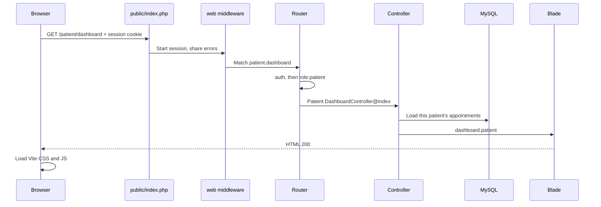
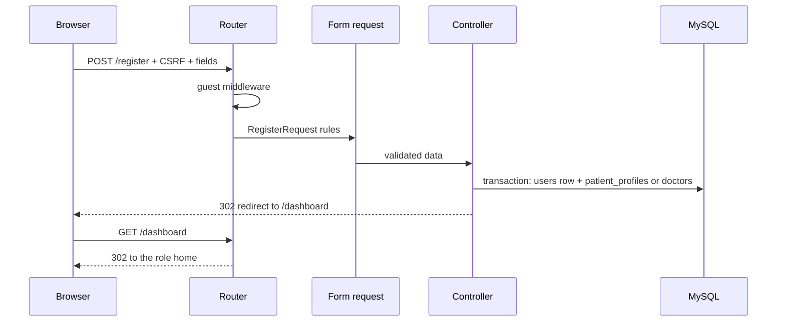
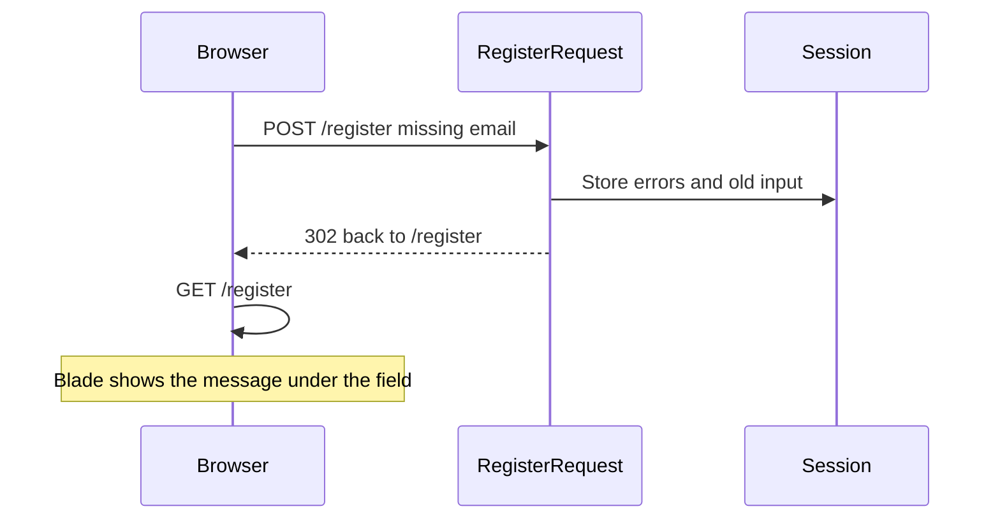
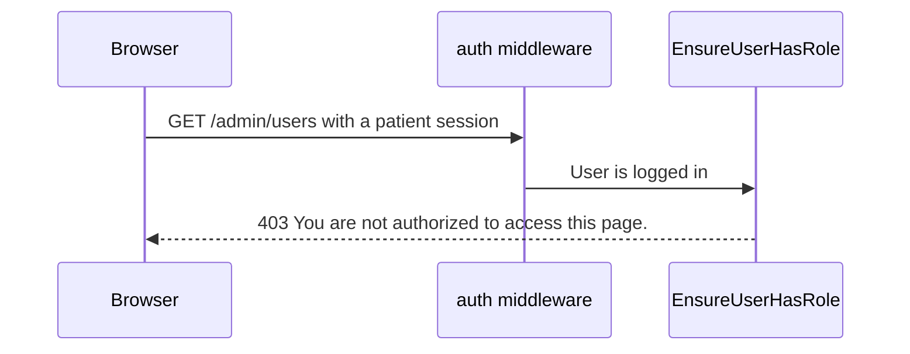

# 02 — Complete request lifecycle

This chapter follows one HTTP request through the Laravel 12 code that is installed here (framework 12.69.3). Older tutorials that start at `app/Http/Kernel.php` do not match this project. The kernel class is not in the application. Configuration is `bootstrap/app.php`.

The order below is the order for a normal browser page. A JSON route uses the same front half and returns JSON instead of Blade. The Stripe webhook skips CSRF. A console command never enters this pipeline.

## 1. URL, DNS, and the web server

**Simple definition:** The address bar is a request for a document.

**Technical definition:** The browser resolves a host, opens a connection (HTTP or HTTPS), and sends a request line, headers, and sometimes a body.

**Why it is used here:** Locally the host is `localhost` (`php artisan about`). `public/index.php` is the front controller. PHP's built-in server or Apache/Nginx must point the site root at `public/`, not at the repository root. If the root is wrong, people can download `.env`.

**Example:** Opening `http://localhost/doctors` sends `GET /doctors` with an `Accept: text/html` header and a cookie if the person has visited before.

## 2. What the request contains

| Part | Meaning | Example in Medicare |
|---|---|---|
| Method | What kind of action | `GET` reads a page. `POST` creates. `PUT` and `PATCH` update. `DELETE` removes |
| URL path | Which route | `/patient/bookings/4/cancel` |
| Query string | Extra filters on a GET | `?query=cardio` on the doctor list, `?range=today` on the receptionist appointment list |
| Headers | Metadata | `Cookie` carries the session id. `X-CSRF-TOKEN` is set by the dashboard layout meta tag for JavaScript |
| Body | Form or JSON | `email`, `password`, files |

HTML forms only send GET or POST. Laravel methods `PUT`, `PATCH`, and `DELETE` are sent as POST with a hidden `_method` field. Blade's `@method('PUT')` prints that field. This is method spoofing. The `web` middleware group lets Laravel honor `_method`.

Route names (`->name('patient.dashboard')`) are stable labels. Templates call `route('patient.dashboard')` so a URI can change without editing every link.

## 3. Front controller

`public/index.php` loads Composer’s autoloader, builds the application from `bootstrap/app.php`, and handles the captured request. If `storage/framework/maintenance.php` exists, visitors see the maintenance page instead.

## 4. Global middleware, then the group

Laravel 12’s default global stack, from `Illuminate\Foundation\Configuration\Middleware::getGlobalMiddleware`, runs first because this app does not replace it:

1. `ValidatePathEncoding`
2. `InvokeDeferredCallbacks`
3. `TrustProxies`
4. `HandleCors`
5. `PreventRequestsDuringMaintenance`
6. `ValidatePostSize`
7. `TrimStrings`
8. `ConvertEmptyStringsToNull`

TrustHosts is off. Then the route’s group runs.

**`web` group** (almost every page), same framework method:

1. `EncryptCookies`
2. `AddQueuedCookiesToResponse`
3. `StartSession` — loads the row in `sessions` and makes `session()` and `auth()` work
4. `ShareErrorsFromSession` — makes `$errors` available in Blade
5. `ValidateCsrfToken` — except `stripe/webhook`
6. `SubstituteBindings` — turns `{appointment}` into an `Appointment` model when the parameter is type-hinted

`auth.session` is not enabled. `authenticateSessions()` is not called in `bootstrap/app.php`.

**`api` group** for `GET /api/user`: Sanctum’s `EnsureFrontendRequestsAreStateful` (because `statefulApi()` is on), then `SubstituteBindings`. No default throttle.

After the group, route middleware runs: `auth`, `guest`, `role:...`, `signed`, `throttle:...`.

`SubstituteBindings` is in the group, and `auth` is route middleware. Laravel’s priority list still runs authentication before binding when both are present, so a missing model returns 404 only after the user has passed `auth`. A guest is redirected to login before a private id is confirmed. That is the framework priority, not a custom class in this repo.

## 5. Route matching

The router compares method and path. First match wins. Important overlaps in this app:

- `GET /doctors/{slug}` is the public profile (`DoctorController@show`). The parameter is a **string slug**, not a doctor id. The controller loads the doctor with `whereHas('user', slug)`.
- `GET /doctors/{doctor}/book` binds a `Doctor` model. Implicit binding uses the numeric primary key `doctors.id`, because `Doctor` does not define `getRouteKeyName`.
- `GET /doctor/patients/create` is registered before `GET /doctor/patients/{patient}`, so the word `create` is not treated as a patient id.
- `GET /doctor/referrals/preview/{preview}` is constrained to `sent-[A-Za-z0-9]+` or `sample-[a-z0-9-]+`.

Scoped bindings are turned on only for some nested report routes in `routes/web.php` (`->scopeBindings()`): patient report show and delete, and doctor appointment report show. Scoped binding means the child `{report}` must belong to the parent `{appointment}`. Other nested pairs, such as referral reports, are checked manually in the controller. A missing scope flag is not proof of a hole if the method checks the relationship itself. Chapter 08 lists which path does which.

If nothing matches, Laravel responds **404**.

## 6. Authentication: who is this user?

**Simple definition:** The session cookie points at a `sessions` row. That row remembers the user id.

**Technical definition:** The default guard is `web` (`config/auth.php`), driver `session`, provider `eloquent`, model `App\Models\User`. `Auth::attempt` checks email and password. Passwords are hashed because `User` casts `password` to `hashed`. Login is rate-limited to 5 attempts per email-and-IP in `LoginRequest::ensureIsNotRateLimited`.

`auth` middleware (`Authenticate`) redirects guests to `route('login')`. It does not check `users.is_active`. A deactivated user who still knows the password can log in. See [chapter 08](08-authentication-authorization-security.md).

`guest` middleware (`RedirectIfAuthenticated`) sends an already logged-in user away from login and registration. The redirect target is the framework default for that middleware unless changed. This app sets `redirectGuestsTo` but does not call `redirectUsersTo`.

The `users` model does **not** implement `MustVerifyEmail` (the import is commented out in `app/Models/User.php`). Verification routes exist, but the application does not force a verified email before dashboards.

## 7. Authorization: which role, which record?

Role middleware `EnsureUserHasRole` (`app/Http/Middleware/EnsureUserHasRole.php`):

```16:29:app/Http/Middleware/EnsureUserHasRole.php
    public function handle(
        Request $request,
        Closure $next,
        string ...$roles
    ): Response {
        $user = $request->user();

        abort_unless(
            $user && in_array($user->role, $roles, true),
            403,
            'You are not authorized to access this page.'
        );

        return $next($request);
    }
```

A patient who opens `/doctor/dashboard` is logged in, so `auth` passes, then `role:doctor` returns **403**.

Role is not ownership. `Doctor\AppointmentController::show` also requires `$appointment->doctor_id` to equal the logged-in doctor’s id. `Patient\BookingController::show` requires `$appointment->patient_id` to equal the logged-in user id. Those checks are the IDOR defense. They are repeated per method, not expressed as a single appointment policy.

## 8. Controller and form request

If the action is a closure (`/`, `/services`, `/dashboard`), that function runs.

If the action is a controller method, Laravel builds the controller and fills parameters:

- `Request` is the current HTTP request.
- A form request such as `StorePatientAppointmentRequest` runs `authorize()` and then `rules()`. Failure of `authorize()` is **403**. Failure of `rules()` throws `ValidationException`.
- An Eloquent type-hint such as `Appointment $appointment` is the bound model.

For a normal HTML form, validation failure redirects back to the previous URL with HTTP **302**, stores errors in the session, and flashes old input except passwords and files. Blade reads them with `$errors` and `old('email')`.

For a request that wants JSON (`Accept: application/json` or `X-Requested-With`), validation failure is HTTP **422** with a JSON body.

## 9. Business rules and the database

After validation, the method applies clinic rules. Example: `Appointment::applyStatus` rejects changes when the current status is `completed` or `cancelled`, and only allows the transitions listed in that method. A status that passes `UpdateAppointmentStatusRequest` can still be rejected here. Validation and business rules are different layers.

Writes use Eloquent `create`, `update`, `save`, or the query builder. `RegisteredUserController::store` wraps user creation and the patient or doctor profile insert in `DB::transaction`, and deletes an uploaded photo if the transaction throws.

The unique column `appointments.active_slot` is set in `Appointment::booted` for non-cancelled visits. Two active visits cannot share the same doctor, date, and start time. A duplicate insert fails at the database even if two requests pass the PHP check together.

## 10. Response

| Kind | How you see it | Status |
|---|---|---|
| HTML page | `return view(...)` | 200 |
| Redirect | `return redirect()->route(...)` or `back()` | 302 |
| JSON | `return response()->json(...)` | 200, or 422 from validation |
| File | `MedicalFile::response` | 200 stream, or 404 |
| Forbidden | `abort(403)` | 403 |
| Missing | `firstOrFail()`, missing model binding | 404 |
| CSRF failure | token missing or stale | 419 |
| Unexpected exception | uncaught throw | 500. With debug on, a stack trace page |

Flash data (`->with('status', 'Profile saved.')`) lives for the next request only. Blade prints `session('status')`.

## 11. Browser rendering

The HTML includes `@vite` tags. The browser fetches CSS and JS, runs Alpine (`resources/js/app.js`), and paints the page. A form `submit` listener disables the clicked submit button to reduce double posts. That is a convenience. The server must still tolerate two requests. The `active_slot` unique index is the real protection for double booking.

## Sequence: opening a page



## Sequence: valid form



Registration is in `RegisteredUserController::store`. `/dashboard` then redirects by `users.role` (`routes/web.php`).

## Sequence: invalid form



The user is not created. No database row is written when validation fails before the controller body.

## Sequence: unauthorized



A request with no session hits `auth` first and is redirected to `/login` (302), not 403.

## HTTP methods used by Medicare

| Method | Used for |
|---|---|
| GET | Pages, JSON lists, file downloads, health check `/up` |
| POST | Create booking, message, review, referral, login, logout, status change |
| PUT | Profile, availability, consultation note, analysis review, clinic settings, password |
| PATCH | Breeze profile update, admin user active flag |
| DELETE | Report, availability exception, receptionist, Breeze account |

## Status codes you will meet

| Code | When |
|---|---|
| 200 | Page, JSON, or file |
| 302 | Redirect after POST or role home |
| 400 | Stripe webhook payload failed signature checks |
| 403 | Wrong role, failed form-request `authorize()`, or failed ownership `abort` |
| 404 | Unknown URL or unknown model id |
| 419 | CSRF token mismatch |
| 422 | Validation failed on a JSON request, or some `abort(422)` business checks |
| 500 | Uncaught exception |

## Related chapters

- Middleware details: [11-middleware-errors-and-responses.md](11-middleware-errors-and-responses.md)
- Field rules: [06-validation-and-input-processing.md](06-validation-and-input-processing.md)
- Debugging a 403: [13-debugging-playbook.md](13-debugging-playbook.md)
