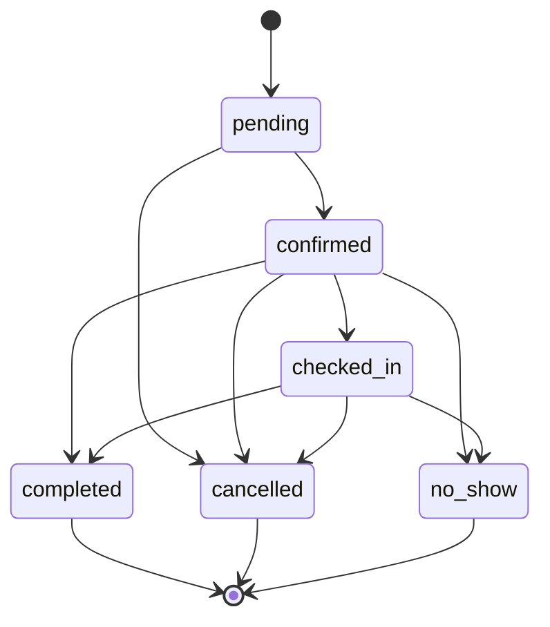
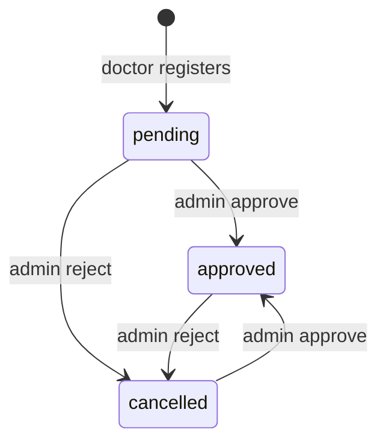

# 09 — Business workflows

Each workflow below is implemented in the repository. Screens that only render static Blade are not workflows.

State names come from code, not from a generic clinic diagram.

## Appointment status

Source: `Appointment::applyStatus`. `completed`, `cancelled`, and `no_show` have no outgoing transitions. The webhook can set `confirmed` or `cancelled` with `forceFill` without calling `applyStatus`. A free booking can be created already `confirmed`. Those paths are outside the diagram and are documented under payments.

`canPatientCancel` is true only for `pending` or `confirmed`, when the start is in the future, and when the start is farther away than `clinic_settings.cancellation_notice_hours` (0 means no extra wait).

`canRefer` is true for `confirmed`, `checked_in`, or `completed`.

## Doctor approval

The reject method does not check the previous status. Approve clears `rejection_reason`. Public booking requires `approved` and `users.is_active` (`AppointmentBooking` and `Public\BookingController`).

## Referral status

Values enforced in `ReferralController`:

| From | To | Who | Condition |
|---|---|---|---|
| sent | accepted | recipient | `respond()` |
| sent | declined | recipient | optional reason |
| accepted | (visit created) | recipient | `schedule` requires status `accepted` |

A second accept of a non-`sent` referral returns 422. `ConsultationReferralTest::test_accept_and_decline_only_move_a_sent_referral_once` passed in this run (it was not in the failure list).

Sample previews (`MockReferralDirectory`, route `doctor.referrals.preview`) are not rows in `referrals` until a real send happens. Tests also cover a sample list entry after a sample send. Read `ReferralController::storePreview` and `preview` together so you do not treat a preview id as a foreign key.

## 1. Patient registration

1. **Objective:** create a patient who can book.
2. **Actor:** guest.
3. **Start:** `/register`.
4. **Input:** `RegisterRequest` fields. Role `patient`.
5. **Authorization:** guest middleware. `authorize()` is true.
6. **Writes:** `users` (role patient, active), `patient_profiles.age`. Transaction.
7. **Result:** logged in, redirect `/dashboard`, then `/patient/dashboard`.
8. **Failure:** validation redirect. Duplicate email hits the unique rule.
9. **Tests:** `RegistrationTest`.

## 2. Doctor registration and approval

Same form with role `doctor`. Writes `doctors.approval_status = pending`. No time slots yet. The doctor can open `/doctor/dashboard` (`AuthenticationTest`). They cannot be booked until an admin approves. Admin uses `admin.doctors.approve` or `reject`. Notification row via `ClinicNotifier::doctorReviewed`. **Tests:** `RegistrationTest::test_doctors_register_as_pending`, `MedicareWorkflowTest::test_admin_approves_a_doctor_and_password_change_requires_the_current_password`.

## 3. Doctor profile and weekly hours

`PUT doctor.profile.update` saves name, phone, fee, biography, qualifications, experiences, and slots. Approval is not in the validated set. `PUT doctor.availability.update` saves the week and duration/buffer. Exceptions block or add windows. **Test:** `ProfileCompletionTest` doctor save **failed** in this audit because phone `5551234` is not 10 digits. `ProfileCompletionTest::test_doctor_saves_weekly_hours_and_appointment_settings` was not in the failure list.

## 4. Receptionist account

A doctor opens `/doctor/receptionists/create` and posts `StoreDoctorReceptionistRequest`. The new user role is `receptionist` and `receptionists.doctor_id` is the doctor. Delete checks that foreign key. The receptionist cannot book until the link exists (`authorize()` on the booking request). **Test:** `ReceptionistDeskTest`.

## 5. Public discovery

`GET /doctors` lists approved active doctors, 9 per page, optional `query`. `GET /doctors/{slug}` shows one profile by user slug. **Tests:** `PublicServicesTest` for services, `DoctorReviewTest` for reviews.

## 6. Booking

**Actors:** patient (public or dashboard form), receptionist, or doctor adding a patient.

**Patient path:**

1. Open `doctors.book` or `patient.book.create`.
2. Guest may POST `doctors.book.remember`. Session key `booking_draft`. Redirect to login. After login, `AuthenticatedSessionController` sends them back.
3. Patient POSTs `doctors.book.store`.
4. Form request checks dates and files.
5. `AppointmentBooking::create` checks approval, active user, horizon (`ClinicSetting` months, default 6), leave, and the open window.
6. Inserts `appointments`. Model sets `active_slot`.
7. If the fee is zero or payment policy does not require Stripe, status becomes `confirmed` and `ClinicNotifier::appointmentBooked` runs.
8. If payment is required, a Stripe Checkout Session is created and the row stays unpaid until the webhook.

**Receptionist path:** `receptionist.appointments.store` creates a **confirmed** visit for the assigned doctor. The receptionist cannot use the patient form (`AppointmentBookingTest`).

**Doctor path:** `doctor.patients.store` creates or reuses a patient and books a confirmed visit. Records `doctor_patients` with who added them (`2026_10_14_180000_track_who_added_patients.php`).

**Duplicate submit:** the browser disables the submit button after one click. Two fast requests can still race. The unique `active_slot` makes the second insert fail.

**Tests:** `AppointmentBookingTest`, `SlotAvailabilityTest`, `MedicareWorkflowTest` (horizon and leave).

## 7. Reschedule and cancel

Patient cancel: `patient.bookings.cancel` if `canPatientCancel()`. Sets status `cancelled`, `cancelled_by`, reason. Saving clears `active_slot`, which frees the time.

Patient reschedule: same future-window check (`canPatientCancel` is reused), then `AppointmentBooking::reschedule`, which writes `appointment_reschedules` and moves the slot.

Receptionist reschedule: ownership by assigned doctor, then the same service. Validation does not by itself repeat the patient notice-hours rule. Read `reschedule()` in the service before assuming both actors share every limit.

Doctor or receptionist cancel: status form with `cancel_reason`, then `applyStatus`.

## 8. Check-in and completion

Receptionist or doctor sets `checked_in` from `confirmed`. Doctor sets `completed` from `confirmed` or `checked_in`. Receptionist validation omits `completed`. `no_show` is available to both from `confirmed` or `checked_in`.

## 9. Consultation note

`PUT doctor.appointments.consult.update` upserts `consultations` for that appointment (unique `appointment_id`). Does not dispatch analysis. **Test:** `ConsultationReferralTest::test_saving_a_consult_persists_the_note_without_starting_analysis` (not in the failure list).

## 10. Reports

**On booking:** files stored by `AppointmentReports` and rows in `appointment_reports`.

**Later:** patient POST `patient.bookings.reports.store` while the visit is not cancelled, under 24 files. Delete removes the row and calls `MedicalFile::delete`. Download streams the private file after an ownership check.

**Tests:** `AppointmentBookingTest::test_patient_can_open_reports_attached_to_a_booking`, `AppointmentConversationTest` upload and delete (those methods were not the failing method).

## 11. Messages

Patient or owning doctor POSTs `body`. Other doctors receive 403 (`AppointmentConversationTest` expects that). Rows go to `appointment_messages`. The page loads them in Blade and can refresh via the JSON index. `visit-chat.js` is the widget. The exchange test **failed** on the final HTML assertion in this audit.

## 12. Referrals

1. Doctor opens a visit that `canRefer()`.
2. Real send: `StoreReferralRequest` plus `ReferralSender`. Copies selected report ids into `referral_reports` and stores a snapshot the recipient can read.
3. Recipient opens `doctor.referrals.show`.
4. Accept or decline once.
5. Schedule creates an appointment for the recipient doctor and the same patient.

**Tests:** `ConsultationReferralTest` (several passed). The analysis-review test **failed** because the recipient saw `Unapproved model summary.`

## 13. AI analysis

1. Doctor POSTs selected report ids.
2. Controller creates an `ai_analyses` row and calls `GenerateAiAnalysis::dispatchSync`.
3. The job extracts text, calls the provider, and `ClinicalOutputValidator` rejects malformed JSON.
4. Empty API key skips the provider (tested).
5. Doctor edits `clinician_summary` and approves. Audits go to `ai_analysis_audits`.
6. Status JSON is polled by `analysis-poll.js`.

A second submit while one analysis is open does not start another job (tested in `DoctorAnalysisWorkflowTest::test_a_second_submit_does_not_start_another_job_while_one_is_open`, not in the failure list).

`GenerateClinicalAnalysis` is not on this path.

## 14. Reviews

A patient POSTs rating and text to `doctors.reviews.store`. Unique `(doctor_id, user_id)` means a second submit updates the same row. Guests and other roles are rejected. **Test:** `DoctorReviewTest`.

## 15. Notifications

`ClinicNotifier` writes `notifications` through `ClinicNotification` (`via` returns `database` only). The header counts unread notifications. Opening one marks it read and redirects to the stored `route()` URL.

There is no reminder scheduler in `routes/console.php`. No mail reminder job was found.

## 16. Payments

`clinic_settings.payment_policy` is `none` or `clinic`. Fee `0` confirms without Stripe. Otherwise `StripeCheckout::createSession` uses currency `usd`. Webhook `checkout.session.completed` sets `payment_status=paid`, `paid_at`, `status=confirmed` when the session id, amount, and currency match. Expired or failed checkout cancels an unpaid row. **Test:** `AppointmentBookingTest::test_verified_webhook_confirms_the_visit_and_a_cancel_frees_the_window`.

## 17. Admin operations

Dashboard counts. Doctor list. User search. Deactivate with the guards in chapter 05. Settings update the single `clinic_settings` row, which booking and cancel read.

## 18. Account password

`PUT /account/password` checks the current password, saves the new one, and logs out other devices. Separate from Breeze `PUT /password`.

## Concurrency

Two patients booking the same slot: both may pass a read of open slots. The unique `active_slot` allows one insert. The other gets a database exception. The user-facing message depends on whether `AppointmentBooking` catches the unique violation. Read the `create` method’s catch block before assuming the message is friendly. This audit confirmed the unique index and the model hook, and did not quote a catch that was not opened.

## Related

[06-validation-and-input-processing.md](06-validation-and-input-processing.md), [12-testing-and-quality-assurance.md](12-testing-and-quality-assurance.md).
